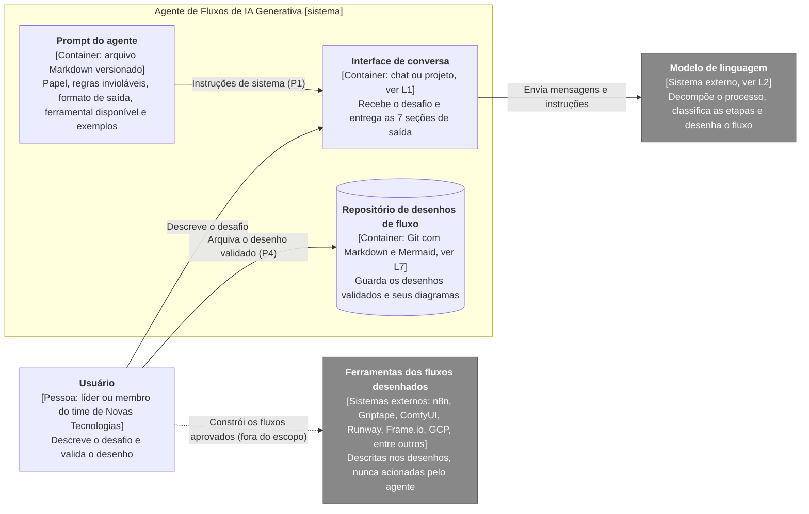
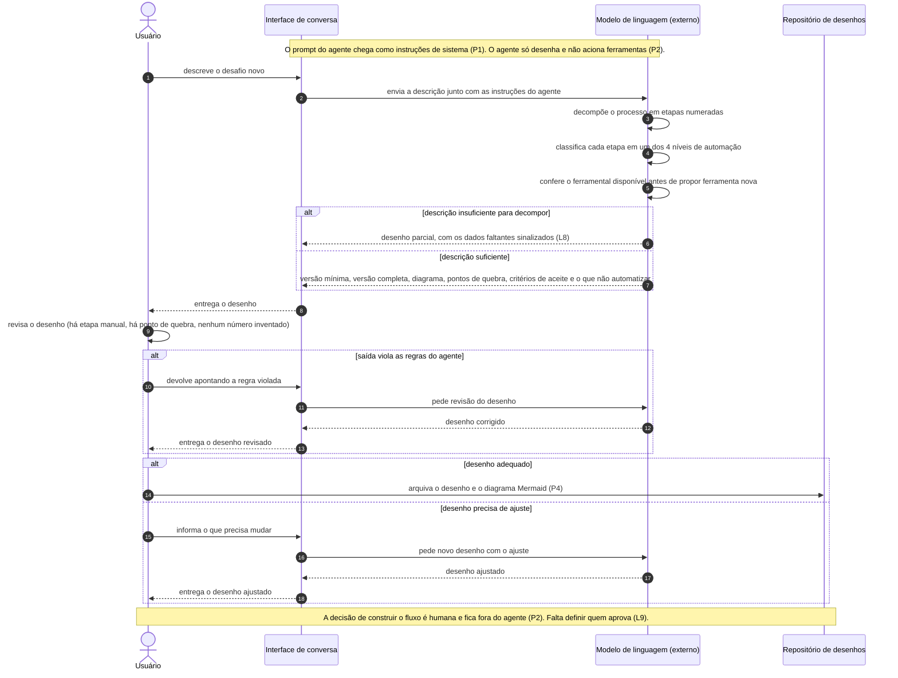

# Agente de Criação de Fluxos de IA Generativa: discovery de documentação

Base de documentação de arquitetura do **Agente de Fluxos de IA Generativa**, produzida na atividade da Unidade III (Modelagem e Geração de Diagramas com Linguagem Natural) do curso da AKCIT/CEIA/UFG.

Objetivos da atividade: documentar o agente como sistema, com seus limites, integrações e comportamento em uma jornada crítica, em texto versionável. O objetivo é que este repositório sirva de contexto para agentes de desenvolvimento implementarem ou evoluírem o sistema com aderência à arquitetura documentada.

**O que o agente faz:** dado um desafio novo de produção, decompõe o processo em etapas, classifica o nível de automação de cada uma, escolhe a ferramenta por etapa dentro do ferramental disponível e descreve o fluxo nó a nó. Ele desenha. Ele não executa nem decide.

**Status do sistema:** prompt definido e ainda sem avaliação formal. Fatos confirmados estão na seção 3. O que ainda não foi decidido está listado como lacuna (L) e não foi preenchido por suposição.

## Sumário

1. [Estrutura do repositório](#1-estrutura-do-repositório)
2. [Descrição do sistema em linguagem natural](#2-descrição-do-sistema-em-linguagem-natural)
3. [Fatos e premissas](#3-fatos-e-premissas)
4. [Diagrama estrutural: containers](#4-diagrama-estrutural-containers)
5. [Diagrama comportamental: pedido de desenho de fluxo](#5-diagrama-comportamental-pedido-de-desenho-de-fluxo)
6. [Decisões e ajustes sobre a saída do modelo](#6-decisões-e-ajustes-sobre-a-saída-do-modelo)
7. [Checklist de revisão em pull request](#7-checklist-de-revisão-em-pull-request)
8. [O que falta para um agente construir sem inventar decisões](#8-o-que-falta-para-um-agente-construir-sem-inventar-decisões)
9. [Como renderizar os diagramas](#9-como-renderizar-os-diagramas)

## 1. Estrutura do repositório

```
.
├── README.md
├── agente/
│   └── prompt-agente-fluxos-genai.md
├── diagramas/
│   ├── containers.mmd
│   └── sequencia-desenho-de-fluxo.mmd
└── docs/
    └── prompts-utilizados.md
```

Os arquivos `.mmd` são a fonte de verdade dos diagramas. Os blocos do README são cópias idênticas, para renderização direta no GitHub. O arquivo em `agente/` é a fonte de verdade do prompt do agente.

## 2. Descrição do sistema em linguagem natural

O Agente de Fluxos de IA Generativa é um assistente definido por um prompt de sistema. Um membro do time de Novas Tecnologias descreve um desafio de produção audiovisual ou de comunicação, e o agente devolve um desenho de fluxo com etapas classificadas por nível de automação, ferramentas escolhidas dentro do ferramental existente, pontos de quebra, critérios de aceite e a lista do que não deve ser automatizado agora. A descrição segue os elementos da especificação: escopo, nível, limites, integrações, restrições e lacunas.

| Elemento | Descrição |
|---|---|
| **Escopo** | Entra: o agente (prompt e regras), a interface de conversa, o repositório onde os desenhos validados são arquivados e as integrações externas do próprio agente. Fica fora: os fluxos que o agente desenha, as ferramentas desses fluxos, a decisão de construí-los e a implementação deles. |
| **Nível da visão** | Estrutural no nível de containers, inspirado no C4. Comportamental com diagrama de sequência da jornada de pedido de desenho de fluxo. Componentes internos e o funcionamento interno do modelo de linguagem não aparecem. |
| **Limites e responsabilidades** | **Usuário:** descreve o desafio, valida o desenho e decide. **Interface de conversa:** recebe o desafio e entrega a saída. **Prompt do agente:** define papel, regras invioláveis, formato de saída, ferramental disponível e exemplos. **Repositório de desenhos:** guarda os desenhos validados. |
| **Integrações externas** | Modelo de linguagem, que executa o prompt. Ferramentas dos fluxos desenhados (n8n, Griptape, ComfyUI, Runway, Frame.io, GCP, entre outras), que aparecem apenas como referência: o agente as descreve, mas nunca as aciona. |
| **Restrições** | O agente não inventa limites de API, preços, tempos de processamento ou capacidades de modelo. Nunca propõe ferramenta nova sem verificar o ferramental existente. Toda etapa é classificada em um de quatro níveis (automatizável agora, automatizável com revisão, assistida, manter manual). Toda saída segue as 7 seções definidas, com versão mínima antes da completa. Toda etapa com modelo generativo tem critério de aceite por checklist humano curto. Proibido adjetivo sem métrica. |
| **Lacunas** | L1 a L11, listadas abaixo. |

### Lacunas

| Id | Lacuna ou pergunta em aberto |
|---|---|
| L1 | Em que interface o agente roda: chat, projeto com instruções fixas ou aplicação própria via API? Quem tem acesso? |
| L2 | Qual modelo de linguagem e qual provedor? A versão fica fixa ou acompanha atualizações? |
| L3 | O agente terá ferramentas próprias (busca na web para checar limites de API, execução de código) ou responde só com texto? Hoje ele apenas é proibido de inventar limites (regra 7), sem meio de verificá-los. |
| L4 | Onde vive a lista de ferramental e quem a mantém? Embutida no prompt, ela desatualiza quando o time muda de ferramenta. |
| L5 | Que dados o usuário pode colar no agente (roteiros, imagens e vozes de talentos, acervo)? Qual a política de dados, LGPD e direito de imagem e voz? |
| L6 | Como saber que o agente funciona? Não há casos de teste de referência nem critério de aceite do próprio agente. |
| L7 | Onde e como os desenhos validados são arquivados: repositório, wiki ou outro? Qual a nomenclatura e o versionamento? |
| L8 | Quando falta um dado (descrição incompleta do processo, limite de API desconhecido), o agente pergunta, desenha marcando `[VERIFICAR]` como no Exemplo B ou omite? A regra 7 só proíbe inventar. |
| L9 | Quem aprova a construção de um fluxo desenhado e como essa decisão se liga a um ADR? |
| L10 | Há limite de custo ou de volume de uso do agente, em tokens ou em número de consultas? |
| L11 | Como o prompt é versionado e como se testa regressão quando o prompt ou o modelo mudam? |

## 3. Fatos e premissas

### Fatos informados

| Id | Fato |
|---|---|
| F1 | O prompt do agente está definido e versionado em `agente/prompt-agente-fluxos-genai.md`: papel, 9 regras invioláveis, 7 seções de saída, 4 níveis de automação e 4 exemplos. |
| F2 | Domínio de atuação: produção audiovisual e comunicação em empresa de mídia, com imagem, vídeo, voz e texto, VFX, stock shots, animações e apoio a pré e pós-produção. |
| F3 | Ferramental declarado no prompt: Python 3.11, FastAPI, Pydantic v2, SDKs de LLM (Anthropic, OpenAI, Gemini), filas e jobs assíncronos, n8n, Griptape, ComfyUI, modelos de difusão, ControlNet, IP-Adapter, rembg, OpenCV, PIL, upscalers, Seedance, Linkg, Runway, síntese de voz, Frame.io, GCP e armazenamento em nuvem. |
| F4 | A saída do agente é em Markdown e inclui um diagrama do fluxo em Mermaid. |

### Premissas assumidas (a confirmar)

| Id | Premissa | Lacuna relacionada |
|---|---|---|
| P1 | O agente é um prompt de sistema executado em uma interface de conversa sobre um modelo de linguagem, sem ferramentas conectadas. | L1, L3 |
| P2 | O agente só desenha. Não aciona as ferramentas dos fluxos e não decide a construção. | L9 |
| P3 | A lista de ferramental está embutida no próprio prompt. | L4 |
| P4 | O usuário leva os desenhos validados ao repositório manualmente. | L7 |
| P5 | Cada conversa é independente. O contexto necessário é fornecido pelo usuário na própria conversa. | L5 |

## 4. Diagrama estrutural: containers



**Leitura do diagrama.** O prompt do agente chega à interface como instruções de sistema, e a interface conversa com o modelo de linguagem, que é externo. O usuário é o elo entre o agente e o mundo real: ele valida o desenho, arquiva o que foi aprovado no repositório e constrói os fluxos nas ferramentas externas (linha tracejada, fora do escopo do sistema). Não existe seta do agente para as ferramentas, porque ele não as aciona (P2).

## 5. Diagrama comportamental: pedido de desenho de fluxo

A jornada de pedido de desenho foi escolhida porque é onde o agente entrega valor e onde estão os riscos: descrição insuficiente, saída que viola as regras e desenho que precisa de ajuste depois da revisão.



**Leitura do diagrama.** O desenho do agente nunca é o fim da jornada. Há duas voltas com validação humana: uma quando a saída viola as regras do agente (revisão) e outra quando o desenho precisa de ajuste (novo desenho). O arquivamento só acontece depois que o desenho é considerado adequado. A decisão de construir fica fora do agente, e quem a aprova ainda precisa ser definido (L9).

## 6. Decisões e ajustes sobre a saída do modelo

O modelo gerou os diagramas a partir do roteiro da seção 2. A tabela registra o que foi decidido ou ajustado ao revisar essa saída.

| Id | Ponto | Decisão ou ajuste | Motivo |
|---|---|---|---|
| D1 | Escopo da documentação | Documentar o agente e seu entorno, não os fluxos que ele desenha. | Os fluxos desenhados mudam a cada uso. Misturá-los ao agente apagaria a fronteira do sistema. |
| D2 | Notação do diagrama estrutural | Usar `flowchart` com `subgraph` em vez de `C4Container` do Mermaid. | A sintaxe C4 do Mermaid é experimental e renderiza de forma irregular entre ferramentas. O `flowchart` renderiza igual no GitHub e no VS Code e mantém a ideia de containers. |
| D3 | Modelo de linguagem e prompt | Modelo como sistema externo. Prompt como container próprio, versionado em arquivo. | Separa o que o time controla (prompt) do que não controla (modelo), e permite revisar mudanças no prompt em pull request. |
| D4 | Ferramentas dos fluxos | Aparecem como sistemas externos, ligados ao usuário por linha tracejada que representa a construção do fluxo, sem seta vinda do agente. | Evita sugerir uma integração que não existe. O agente só descreve as ferramentas. |
| D5 | Ferramentas do próprio agente | Nenhuma ferramenta própria foi desenhada. | Não há informação de que o agente tenha busca ou execução de código (L3). Desenhar seria inventar. |
| D6 | Validação humana na sequência | As duas voltas de validação humana (revisão das regras e ajuste do desenho) aparecem explícitas. | O objetivo do agente é entregar insumo para decisão, e o diagrama precisa mostrar onde a decisão fica com a pessoa. |
| D7 | Dado faltante | Representado como caminho alternativo com os dados faltantes sinalizados, sem pergunta ao usuário. | O prompt só proíbe inventar (regra 7). Mudar para perguntas exige decisão e está em L8. |

## 7. Checklist de revisão em pull request

1. Os diagramas estão no nível de containers ou na sequência, sem misturar componentes internos?
2. O modelo de linguagem e as ferramentas dos fluxos estão marcados como externos?
3. Existe alguma seta do agente para as ferramentas dos fluxos? Se existir, contradiz P2.
4. O prompt citado nos diagramas é o mesmo de `agente/prompt-agente-fluxos-genai.md`?
5. Cada premissa (P) e cada lacuna (L) citada nos diagramas existe nesta página?
6. O README e os arquivos `.mmd` estão idênticos?
7. As duas voltas de validação humana continuam no diagrama de sequência?
8. O caminho de dado faltante continua coerente com L8?
9. Uma mudança no prompt alterou regras, níveis ou seções de saída sem atualizar este README?
10. As decisões novas viraram linha na seção 6 ou um ADR?
11. Nenhum dado de talento, voz, imagem ou acervo aparece em exemplos ou nos prompts registrados?

## 8. O que falta para um agente construir sem inventar decisões

Hoje o repositório dá ao agente de desenvolvimento os limites, as integrações e o prompt. Falta o que ele precisaria para não decidir sozinho:

- **Decisão de interface e modelo:** em que ambiente o agente roda e com qual modelo e versão (L1, L2). Sem isso, um agente de desenvolvimento escolheria um ambiente por conta própria.
- **Contrato da saída:** template das 7 seções, com campos obrigatórios e formato de cada tabela, para que a saída possa ser validada por máquina.
- **Catálogo de ferramental estruturado:** arquivo à parte, com nome, versão, uso aprovado e limites conhecidos de cada ferramenta, em vez de lista dentro do prompt (L4).
- **Casos de teste de referência:** desafios reais anonimizados com o desenho esperado em critérios verificáveis, para medir regressão quando o prompt ou o modelo mudarem (L6, L11).
- **Regra para dado faltante:** decidir se o agente pergunta, marca `[VERIFICAR]` como no Exemplo B ou omite (L8).
- **Política de dados:** o que pode ser colado no agente, com tratamento de LGPD, imagem e voz de talentos (L5).
- **Ferramentas do agente:** se terá busca na web ou execução de código para checar limites de API, e com que permissões (L3).
- **Arquivamento e decisão:** convenção de nomes dos desenhos, modelo de ADR para a decisão de construir e responsável por aprovar (L7, L9).
- **Limites de uso:** orçamento de tokens e volume esperado (L10).
- **Arquivo de regras para agentes:** um `AGENTS.md` ou `CLAUDE.md` com as dependências proibidas (o agente não aciona ferramentas dos fluxos) e a instrução de perguntar em vez de assumir quando houver lacuna.

## 9. Como renderizar os diagramas

- **GitHub:** os blocos `mermaid` deste README são renderizados automaticamente.
- **VS Code:** instale uma extensão de preview de Mermaid, por exemplo `Markdown Preview Mermaid Support`, e abra o preview do README (`Ctrl+Shift+V`). Para os arquivos `.mmd`, use uma extensão que dê preview de Mermaid em arquivo próprio.
- **Alternativa:** cole o conteúdo de um `.mmd` no editor online em <https://mermaid.live>.

## Prompts

Os prompts usados na geração dos diagramas estão em [`docs/prompts-utilizados.md`](docs/prompts-utilizados.md).
